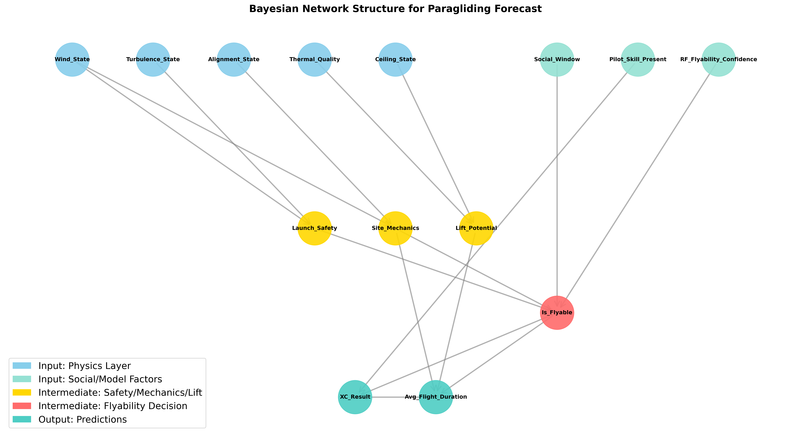

# Background for site-specific paragliding forecasting in the north German flatlands

## Motivation

There exist some direct paragliding flyability applications like [paraglidable.com](https://paraglidable.com) and [Burnair](https://burnair.cloud), however, they both seem to be very "dramatic" with respect to the conditions. Especially paraglidable has a deep neural network trained on dominantly alpine flying data. This approach does not generalize well to our region because:

1. **Alpine vs. flatland conditions differ significantly**: Mountain flying involves ridge lift, orographic effects, and terrain-induced turbulence patterns that don't exist in flat terrain
2. **Training data bias**: Models trained on alpine data overweight factors like terrain slope, valley wind patterns, and altitude effects that are irrelevant in flatlands

In the flatlands of northern Germany (Niedersachsen) we have some special considerations:
* **Wind tolerance**: Stronger winds don't necessarily lead to turbulent and dangerous flying conditions due to lack of terrain obstacles
* **Data sparsity**: Relatively sparse flight data makes deep learning approaches impractical (overfitting risk)
* **Social factors**: No flights on a working day does not mean the site was not flyable - weekday vs weekend patterns must be accounted for
* **Thermal characteristics**: Flatland thermals are weaker and more dependent on surface characteristics (fields, forests, urban areas) rather than terrain elevation

## Data sources

### Weather

* **Source**: [OpenMeteo](https://open-meteo.com/) historic and forecast API
* **Coverage**: 2018-01-01 to present
* **Pressure level data**: Temperature and wind at 850 hPa (approximately 1,500m altitude) for pre-2022 days
* **Aggregation**: Hourly data aggregated for each day from 10:00 to 18:00 local time (typical soaring window)
* **Key variables**:
  - Wind speed and direction (surface and 850 hPa)
  - Temperature and lapse rate (thermal strength indicator)
  - Precipitation and cloud cover
  - Sunshine duration (thermal trigger)

### DHV XC

* **Source**: [DHV XC](https://www.dhv-xc.de/) - German Hang Gliding Association cross-country database
* **API**: Convenient public JSON API (allows easy site identification)
* **Coverage**: 2018-01-01 to present
* **Data richness**: Includes flight duration, distance, XC score, pilot information, launch coordinates, and more
* **Advantage**: Most complete and reliable dataset for the region

### Xcontest

* **Source**: [XContest](https://www.xcontest.org/) - International paragliding and hang gliding contest platform
* **Access method**: HTML parsing with authentication (no public API)
* **Coverage**: 2018-01-01 to present
* **Data gaps**: Some fields missing in base data (exact start coordinates to distinguish nearby launches like Rammelsberg NW and SW, flight duration)
* **Usage**: Supplementary data source for days when DHV XC flights are not available

## Models

### Random Forest

* **Approach**: Supervised classification for binary flyability prediction (flyable/not flyable)
* **Advantage**: Site-specific models capture local characteristics (terrain, orientation, typical weather patterns)
* **Training strategy**: 
  - Includes only flying days and weekends to remove social factors
  - Balanced dataset of flyable and unflyable dates
  - Uses weather conditions as features, flight occurrence as label
* **Feature engineering** (7 key features):
    * `avg_wind_speed` - Mean ground wind speed during soaring window
    * `avg_wind_alignment` - Wind direction alignment with site orientation (see below)
    * `max_wind_gust` - Safety indicator for turbulent conditions
    * `min_wind_speed` - Minimum wind to start and maintain ridge lift
    * `total_sunshine` - Thermal strength proxy
    * `total_precipitation` - Soaring inhibitor
    * `max_lapse_rate` - Atmospheric stability indicator (thermal potential)
* **Hyperparameters**: 200 trees with max depth of 5
* **Performance**: Up to 84% accuracy in 5-fold cross-validation
* **Feature importance insights**:
  - `avg_wind_alignment = cos(avg_wind_direction - site_direction)` is dominant (>50% for many sites)
  - Wind alignment captures the critical factor for ridge soaring sites
  - `total_precipitation` is consistently least important (~2% for Börry)
* **Interpretation**: Model effectively learns that wind direction relative to site orientation is the primary flyability factor in flatland ridge soaring

### Bayesian Network

* **Approach**: Probabilistic graphical model for multi-output prediction and causal reasoning
* **Advantages over Random Forest**:
  - Explicitly models correlations between variables (interpretable structure)
  - Learns multiple output variables simultaneously (flyability, expected XC score, expected flight duration)
  - Handles missing data gracefully through probabilistic inference
  - Can incorporate domain knowledge through network structure -> main benefit for sparse data with respect to deep learning
* **Social factor modeling**: Accounts for weekday/weekend effects and pilot skill levels explicitly
* **Three-tier hierarchical approach**:
  1. **Regional prior model**: Uses general weather patterns across all sites in northern Germany
     - Learns baseline relationships between weather and flying
     - Provides robust estimates even with limited site-specific data
  2. **Site-specific model**: Incorporates local characteristics (orientation, terrain, typical conditions)
     - Updates regional priors with site-specific evidence
     - Produces generic forecasts for any pilot at the site
  3. **Personalized forecast**: Conditions on pilot-specific information when available
     - Takes into account pilot skill level (affects flight duration and XC score predictions)
     - Adjusts for pilot preferences and typical flying behavior
* **Inference**: Uses Variable Elimination algorithm for computing conditional probability distributions
* **Output**: Provides probability distributions over discrete outcomes rather than point predictions (e.g., P(Flyable|weather), P(XC_Score_Category|weather, site, pilot))
* **Discretization**: Continuous weather variables are binned into interpretable categories (e.g., wind speed: Low/Medium/High) to enable tractable probabilistic inference
* **Disadvantage**: Physical parameters need careful discretization (handling continuous random variables is more complicated)

### SVM Regressor (SVR)

* **Approach**: Support Vector Regression with RBF kernel as a complement to the Random Forest classifier
* **Rationale**: Different inductive bias (margin-maximizing, kernel-based) compared to RF; captures different patterns, especially in lower-data regimes where the RF may overfit
* **Preprocessing**: `StandardScaler` inside a `sklearn.Pipeline` — no data leakage during CV
* **Features** (8 features — 5 base + 3 interaction terms):
    * `avg_wind_speed` - Mean ground wind speed during soaring window
    * `avg_wind_alignment` - Wind direction alignment with site orientation
    * `min_wind_speed` - Minimum wind to maintain ridge lift
    * `total_precipitation` - Soaring inhibitor
    * `max_lapse_rate` - Atmospheric stability indicator
    * `gust_factor` - Ratio of gust to mean wind (turbulence proxy)
    * `effective_wind` - `avg_wind_speed × avg_wind_alignment` (usable ridge lift)
    * `thermal_potential` - `max_lapse_rate × total_sunshine` (convective energy proxy)
* **Target**: `log1p(flight_count)` — regression on log-transformed daily flight count
* **Flyability conversion**: SVR log-count output is mapped to [0, 1] via a sigmoid centred at `FLYABLE_THRESHOLD=0.5` with `SIGMOID_SCALE=0.5`, producing a smooth probability rather than a hard threshold
* **Feature importance**: Permutation importance (10 repeats, scored by RMSE) since native `feature_importances_` is unavailable for SVR
* **Hyperparameters**: RBF kernel, `C=10`, `epsilon=0.1`, `gamma='scale'`
* **Output**: Saved as a single `Pipeline` object (`StandardScaler` + `SVR`) so predictions on new data are automatically scaled correctly

### Ensemble (RF + SVR Blend)

* **Approach**: Weighted blend of Random Forest class probability and SVR-derived flyability probability
* **Formula**: `ensemble_prob = α × rf_prob + (1 − α) × svm_prob`
* **Alpha selection**: Per-site optimal α found via out-of-fold (OOF) sweep on 5-fold CV. Both models are trained on identical folds to ensure fair comparison
* **Rationale**: RF and SVR have complementary strengths — RF excels at binary boundary detection while SVR captures continuous count relationships. Blending reduces variance and improves calibration
* **Performance**: Ensemble F1 consistently matches or exceeds standalone models across all sites (typical improvement: +1–3% F1 over best individual model)
* **Cross-site results** (representative):

  | Site | Days | RF F1 | SVM F1 | Ensemble F1 | Best α |
  |------|------|-------|--------|-------------|--------|
  | Börry | 1141 | 0.848 | 0.846 | 0.858 | 0.65 |
  | Königszinne | 974 | 0.745 | 0.748 | 0.761 | 0.30 |
  | Rammelsberg NW | 1114 | 0.834 | 0.826 | 0.843 | 0.35 |
  | Porta | 817 | 0.848 | 0.828 | 0.851 | 0.85 |
  | Dielmissen | 869 | 0.758 | 0.757 | 0.780 | 0.40 |
  | Brunsberg | 960 | 0.852 | 0.860 | 0.879 | 0.35 |

* **Inference**: `predict_ensemble()` returns `ensemble_prob`, `is_flyable`, `rf_prob`, `svm_prob` — used by the forecast API
* **Persistence**: Saved as a single `.joblib` containing both fitted models, optimal α, and metadata

## Data Quality

### Label Noise Mitigation

Flight data labels (flyable/not flyable) are inherently noisy because absence of flights does not always imply unflyable conditions. Two site-specific strategies address this:

#### Minimum capture date (Porta)
* **Problem**: Pre-2020 flights at Porta were predominantly hang gliders (different wind requirements). Including this data degrades paragliding model accuracy
* **Solution**: `SITE_MIN_DATE = {'Porta': 2020-01-01}` — training data starts from 2020 only
* **Impact**: Porta F1 improved from 0.79 → 0.85

#### Competitor site filtering (Dielmissen)
* **Problem**: On days with good wind alignment, zero flights may occur not because conditions are bad but because pilots chose a nearby competing site instead
* **Diagnosis**: `diagnose_competitor_effect()` shows zero-flight days where competitor sites had flights, broken down by wind alignment quality
* **Filter logic**: Remove days where `flight_count == 0` AND `competitor_flights > 0` AND `avg_wind_alignment > 0.6`
* **Competitor definitions**: `{'Dielmissen': ['Börry', 'Königszinne']}`
* **Impact**: Dielmissen F1 improved from 0.66 → 0.78 (93 ambiguous days removed)
* **Non-applicability**: The same analysis for Königszinne showed `zero_comp_rate = 0.0` in the good-alignment bin — no competitor-stealing effect, so no filter applied
